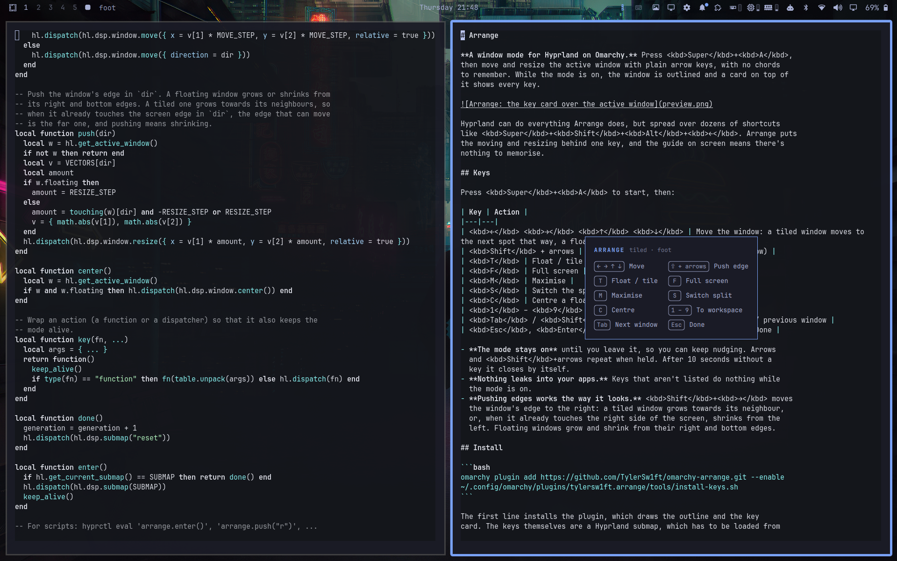

<p align="center"></p>

<h1 align="center">Arrange</h1>

**A window mode for Hyprland on Omarchy.** Press <kbd>Super</kbd>+<kbd>A</kbd>,
then move and resize the active window with plain arrow keys, with no chords
to remember. While the mode is on, the window is outlined and a card on top of
it shows every key.



Hyprland can do everything Arrange does, but spread over dozens of shortcuts
like <kbd>Super</kbd>+<kbd>Shift</kbd>+<kbd>Alt</kbd>+<kbd>←</kbd>. Arrange puts
the moving and resizing behind one key, and the guide on screen means there's
nothing to memorise.

## Keys

Press <kbd>Super</kbd>+<kbd>A</kbd> to start, then:

| Key | Action |
|---|---|
| <kbd>←</kbd> <kbd>→</kbd> <kbd>↑</kbd> <kbd>↓</kbd> | Move the window: a tiled window moves to the next spot that way, a floating one moves a step |
| <kbd>Shift</kbd> + arrows | Push the window's edge that way (see below) |
| <kbd>T</kbd> | Float / tile |
| <kbd>F</kbd> | Full screen |
| <kbd>M</kbd> | Maximise |
| <kbd>S</kbd> | Switch the split (side by side ↔ stacked) |
| <kbd>C</kbd> | Centre a floating window |
| <kbd>1</kbd> – <kbd>9</kbd> | Send the window to that workspace |
| <kbd>Tab</kbd> / <kbd>Shift</kbd>+<kbd>Tab</kbd> | Arrange the next / previous window |
| <kbd>Esc</kbd>, <kbd>Enter</kbd> or <kbd>Super</kbd>+<kbd>A</kbd> | Done |

- **The mode stays on** until you leave it, so you can keep nudging. Arrows
  and <kbd>Shift</kbd>+arrows repeat when held. After 10 seconds without a
  key it closes by itself.
- **Nothing leaks into your apps.** Keys that aren't listed do nothing while
  the mode is on.
- **Pushing edges works the way it looks.** <kbd>Shift</kbd>+<kbd>→</kbd> moves
  the window's edge to the right: a tiled window grows towards its neighbour,
  or, when it already touches the right side of the screen, shrinks from the
  left. Floating windows grow and shrink from their right and bottom edges.

## Install

```bash
omarchy plugin add https://github.com/TylerSw1ft/omarchy-arrange.git --enable
~/.config/omarchy/plugins/tylersw1ft.arrange/tools/install-keys.sh
```

The first line installs the plugin, which draws the outline and the key
card. The keys themselves are a Hyprland submap, which has to be loaded from
Hyprland's config: `install-keys.sh` shows the short block it will add to
the end of `~/.config/hypr/hyprland.lua`, asks before changing anything,
backs the file up first and reloads Hyprland. It also warns you if
<kbd>Super</kbd>+<kbd>A</kbd> is already in use.

<details>
<summary>Prefer to add it by hand?</summary>

Add this to the end of `~/.config/hypr/hyprland.lua` and reload Hyprland:

```lua
-- Arrange window mode (Omarchy plugin tylersw1ft.arrange). Skipped if the plugin is removed.
local arrange_binds = (os.getenv("HOME") or "") .. "/.config/omarchy/plugins/tylersw1ft.arrange/hypr/arrange.lua"
local arrange_file = io.open(arrange_binds, "r")
if arrange_file then
  arrange_file:close()
  dofile(arrange_binds)
end
```

The block checks for the file first, so removing the plugin can't break
your Hyprland config.
</details>

**Requirements:** Omarchy Quattro, with Hyprland's Lua config (tested on
Hyprland 0.56). Nothing else to install.

## Customise

The settings are at the top of `hypr/arrange.lua`:

| Setting | Default | Meaning |
|---|---|---|
| `MOVE_STEP` | `60` | Pixels a floating window moves per arrow press |
| `RESIZE_STEP` | `60` | Pixels an edge moves per <kbd>Shift</kbd>+arrow press |
| `EDGE_SLACK` | `40` | How close to the screen edge still counts as touching it |
| `IDLE_MS` | `10000` | How long the mode waits for a key before closing |

To use a different key than <kbd>Super</kbd>+<kbd>A</kbd>, change the two
`"SUPER + A"` bindings in the same file. Reload Hyprland after any change.

Scripts and other bindings can drive Arrange too:

```bash
hyprctl eval 'arrange.enter()'      # start the mode
hyprctl eval 'arrange.push("r")'    # push the right edge, without the mode
```

## How it works

- `hypr/arrange.lua` defines the mode as a Hyprland submap called `arrange`,
  so Hyprland itself handles every key, with nothing running in between.
- `Service.qml` runs inside omarchy-shell. When Hyprland reports that the
  submap is active, it draws the outline and the card on a click-through
  layer that never takes keyboard focus, refreshing the window's position
  over Hyprland's IPC a few times a second. While the mode is off, it does
  nothing at all.
- The card uses your Omarchy theme's colours and font.

## Uninstall

```bash
~/.config/omarchy/plugins/tylersw1ft.arrange/tools/remove-keys.sh
omarchy plugin remove tylersw1ft.arrange
```

`remove-keys.sh` takes the block back out of `hyprland.lua` (with a backup)
and reloads Hyprland.

## License

[MIT](LICENSE)
